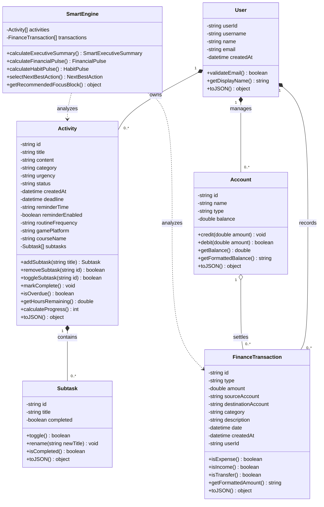

# Class Diagram Sistem Catatan Harian & Finansial

Dokumen ini memuat spesifikasi visual dan teks dari **Class Diagram** yang telah diselaraskan dengan basis data MySQL (`database/schema.sql`) dan implementasi OOP TypeScript (`src/models/`).

---

## 1. Kode Diagram (Mermaid)

Anda dapat menyalin kode Mermaid di bawah ini ke editor Markdown (seperti GitHub, Notion, Obsidian) atau ke [Mermaid Live Editor](https://mermaid.live/) untuk merender diagram visualnya secara langsung:

---

## 2. Lokasi File Kerangka Kode (Skeleton Code di Proyek)

Implementasi kelas-kelas di atas tersimpan pada folder:
`src/models/`

| Nama File | Kelas Utama | Deskripsi |
| :--- | :--- | :--- |
| `src/models/User.ts` | `User` | Entitas pengguna tanpa atribut `photoUrl`. |
| `src/models/Subtask.ts` | `Subtask` | Rincian langkah kegiatan dengan atribut `title` dan `completed`. |
| `src/models/Activity.ts` | `Activity` | Entitas aktivitas, mencakup kategori `gamePlatform`, `courseName`, `routineFrequency`. |
| `src/models/FinanceTransaction.ts` | `FinanceTransaction` | Transaksi keuangan (pemasukan, pengeluaran, transfer). |
| `src/models/Account.ts` | `Account` | Rekening/dompet (Bank, E-Wallet, Cash) dan kalkulasi saldo. |
| `src/models/SmartEngine.ts` | `SmartEngine` | Mesin analisis offline (`calculateExecutiveSummary`, `calculateFinancialPulse`, `calculateHabitPulse`). |
| `src/models/index.ts` | Export Barrel | Titik ekspor untuk mempermudah `import { ... } from './models';`. |
